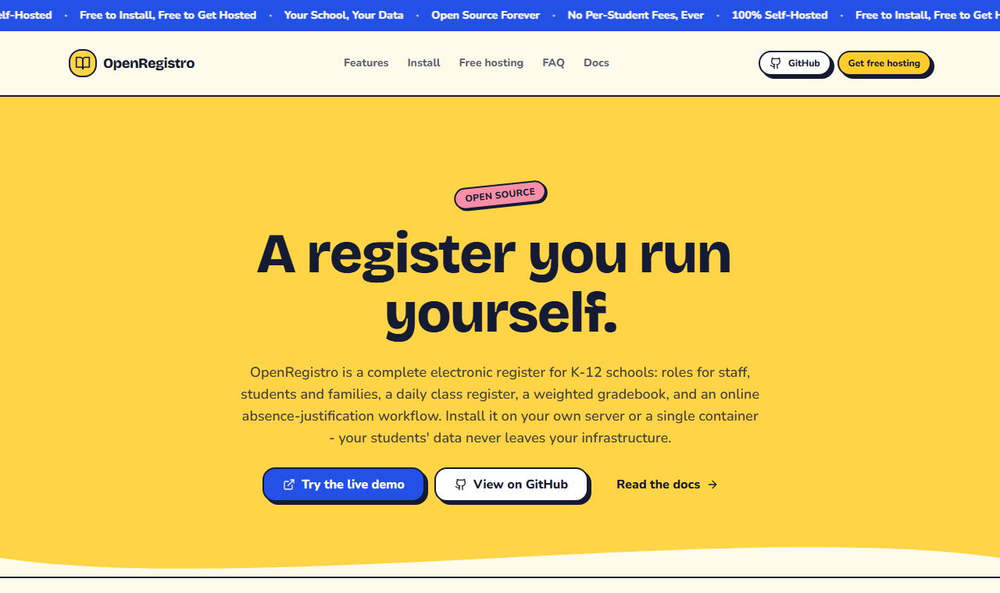
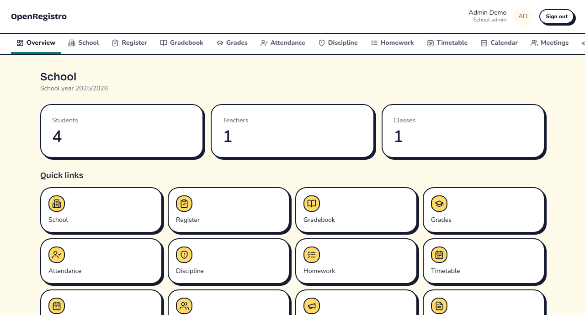

<div align="center">
  
</div>

<div align="center">

<p>
  <a href="https://github.com/Leo-Galli/openregistro/actions/workflows/ci.yml"></a>
  <a href="./LICENSE"></a>
  <a href="./docs/installation.md"></a>
  <a href="./CONTRIBUTING.md"></a>
</p>

<p>
  <a href="https://openregistro-demo.vercel.app"></a>
  <a href="https://openregistro.vercel.app/host"></a>
  <a href="https://openregistro.vercel.app/docs"></a>
</p>

</div>

Open source, self-hosted school electronic register (gradebook) for K-12 schools - roles for
staff, students and families, a daily class register, a weighted gradebook, and an online
absence-justification workflow. Install it on your own server or a single container; your
students' data never leaves your infrastructure.

> Status: core feature set complete (school records, register, gradebook, absence
> justifications, homework, announcements, report cards, audit log, timetable, disciplinary
> notes, calendar, and parent-teacher meeting booking) and running behind CI. See `docs/`
> for installation and architecture, and [CHANGELOG.md](./CHANGELOG.md) for what's shipped
> so far and what's deliberately still a gap.

## Screenshots

<div align="center">
  
  <p><sub>Marketing site - <a href="https://openregistro.vercel.app">openregistro.vercel.app</a></sub></p>
  <br />
  
  <p><sub>Dashboard overview on the live demo - <a href="https://openregistro-demo.vercel.app">openregistro-demo.vercel.app</a></sub></p>
</div>

The entire app - not just the marketing site - uses the same light-only "Pop Ledger" design
system (`packages/ui`): hard offset shadows, thick ink borders, and one base theme that any
school can accent with its own brand color from `/dashboard/school/branding`. Additional base
themes are welcome as pull requests - see [`docs/theming.md`](./docs/theming.md).

## Features

- Role-based access for school admins, secretary staff, principals, teachers, students, and
  guardians, enforced server-side on every action.
- Class register: lesson logs with sign-off, attendance tracking, absence justifications.
- Gradebook with weighted averages, separate end-of-term evaluations, and PDF report cards.
- Homework, school-wide or class-scoped announcements with read receipts, a weekly
  timetable, disciplinary notes, a shared calendar, and parent-teacher meeting booking.
- An audit log for sensitive changes, TOTP two-factor authentication, and a self-service
  personal data export.
- A base theme system (`packages/ui/src/themes`) plus a per-school accent color - one brand
  shipped today, more welcome via pull request.
- Two storage backends behind one interface: JSON files (no database required) or
  PostgreSQL, selected at install time.

## Monorepo layout

<table>
<tr><td><code>apps/web</code></td><td>the register application (self-hosted by schools)</td></tr>
<tr><td><code>apps/website</code></td><td>marketing and documentation site</td></tr>
<tr><td><code>packages/ui</code></td><td>design system - tokens, components, base themes</td></tr>
<tr><td><code>packages/core</code></td><td>domain types, validation, RBAC, storage driver interface</td></tr>
<tr><td><code>packages/db</code></td><td>storage drivers (<code>json</code>, <code>postgres</code>)</td></tr>
<tr><td><code>docker/</code>, <code>scripts/</code>, <code>docs/</code></td><td>deployment, operations, documentation</td></tr>
</table>

## Quick start

```bash
pnpm install
pnpm dev:json
```

No database required for `dev:json` - data is stored as JSON files under `data/`.

For a production-like stack with PostgreSQL:

```bash
docker compose up
```

Or a database-free Docker setup using the JSON driver:

```bash
docker compose -f docker-compose.json.yml up
```

## Documentation

<table>
<tr><td><a href="./docs/installation.md">Installation</a></td><td>self-hosting from scratch, Docker or Node</td></tr>
<tr><td><a href="./docs/configuration.md">Configuration</a></td><td>environment variables and the setup wizard</td></tr>
<tr><td><a href="./docs/architecture.md">Architecture</a></td><td>monorepo layout, the StorageDriver abstraction</td></tr>
<tr><td><a href="./docs/theming.md">Theming</a></td><td>the base theme system and how to contribute one</td></tr>
<tr><td><a href="./docs/backups.md">Backups</a></td><td>backing up and restoring both storage drivers</td></tr>
<tr><td><a href="./docs/gdpr.md">GDPR / data protection</a></td><td>what personal data is stored and how to export or erase it</td></tr>
<tr><td><a href="./docs/api-reference.md">Server actions reference</a></td><td>every mutating server action, by feature area</td></tr>
</table>

## License

AGPL-3.0-only. See [LICENSE](./LICENSE).

## Contributing

See [CONTRIBUTING.md](./CONTRIBUTING.md) - including [`docs/theming.md`](./docs/theming.md) if
you want to contribute a new base theme.

<div align="center">
  <sub>Built with Next.js, Tailwind CSS, and Drizzle ORM - no telemetry, no vendor lock-in.</sub>
</div>
