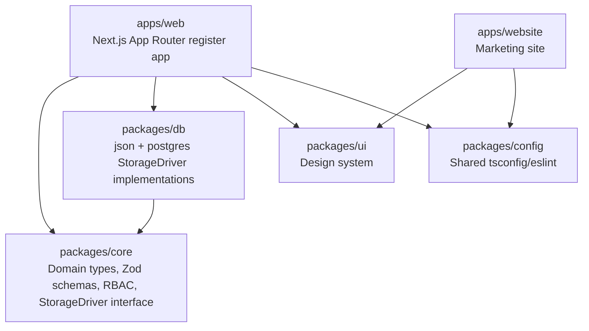

# Architecture

## Monorepo

pnpm workspaces + Turborepo. Two apps, four shared packages:



## The StorageDriver abstraction

Every piece of persisted state (schools, users, grades, attendance, announcements, audit
log, ...) is accessed through one `StorageDriver` interface, defined in
`packages/core/src/storage/driver.ts`. Two implementations satisfy it:

- **`json`** (`packages/db/src/json`): each entity type is a flat JSON file under `DATA_DIR`,
  with atomic writes (write-to-temp-then-rename) and an advisory file lock to serialize
  concurrent writers. No external dependency - this is what makes `pnpm dev:json` and the
  JSON-only Docker Compose file work with zero infrastructure.
- **`postgres`** (`packages/db/src/postgres`): Drizzle ORM over a single Postgres database,
  with SQL migrations committed under `packages/db/src/postgres/drizzle/`.

Both implementations are exercised by the same Vitest contract suite
(`packages/db/src/json/json-driver.test.ts` and `.../postgres/postgres-driver.test.ts`, the
latter gated on `DATABASE_URL` being set) - the same test assertions run against both
drivers, so the app can never observe a behavioral difference between them beyond which
infrastructure they need.

`apps/web/lib/storage.ts` picks the driver at startup based on `STORAGE_DRIVER` and caches
the connected instance on `globalThis` so Next.js dev-mode hot reloads reuse it instead of
leaking a new connection pool on every edit.

## Request flow and authorization

```mermaid
sequenceDiagram
    participant Browser
    participant ServerComponent as Server Component / Action
    participant Authz as lib/authz.ts
    participant Zod as Zod schema (packages/core)
    participant Storage as StorageDriver

    Browser->>ServerComponent: navigate / submit form
    ServerComponent->>Authz: auth() -> session; requirePermission(session, permission)
    Authz-->>ServerComponent: redirect('/forbidden') if not authorized
    ServerComponent->>Zod: parse/validate input
    Zod-->>ServerComponent: typed, validated data (or field errors)
    ServerComponent->>Storage: read/write via StorageDriver methods
    Storage-->>ServerComponent: typed domain entities
    ServerComponent-->>Browser: rendered page / revalidated data
```

Key points:

- `apps/web/proxy.ts` (Next.js's `middleware.ts` convention, renamed to `proxy.ts` in Next.js 16)
  exists only to generate a per-request Content-Security-Policy nonce. It does not perform
  auth/installer gating: both storage drivers use Node-only APIs (`fs`, the Postgres driver) that
  may not be available in every proxy runtime, so that gating happens in server layouts/pages via
  `lib/guards.ts` instead.
- Every mutating Server Action re-checks permissions and re-validates input server-side via
  `requirePermission()` and a Zod schema from `packages/core`, even when the UI already hid
  the triggering control from unauthorized roles.
- Authentication is Auth.js (NextAuth v5) with a Credentials provider: email/password
  (Argon2id-hashed) plus an optional TOTP code, verified against the active `StorageDriver`.

## RBAC model

`packages/core/src/rbac/roles.ts` defines six roles (`school_admin`, `secretary`,
`principal`, `teacher`, `student`, `guardian`) and a flat permission list (e.g.
`grades:write`, `attendance:review`). `ROLE_PERMISSIONS` maps each role to the permissions it
holds; `hasPermission(role, permission)` is the single source of truth `requirePermission()`
calls into.

Role-level permissions answer "can this kind of user ever do X" - a second layer,
`packages/core/src/rbac/scope.ts`, answers "can _this specific_ user do X _to this specific
record_" (e.g. `canTeacherActOnClassSubject`, `isGuardianOfStudent`). Server actions check
both: a permission check first, then a scope check before touching another user's data.

## Data model

See `packages/core/src/domain/*.ts` for the full set of Zod schemas (one file per domain
area: school structure, register, grades, calendar, announcements, report cards, audit).
Entity ids are branded string types (e.g. `SchoolId`, `UserId`) via Zod's `.brand()`, so the
compiler catches passing a `ClassId` where a `SubjectId` is expected even though both are
plain strings at runtime.
